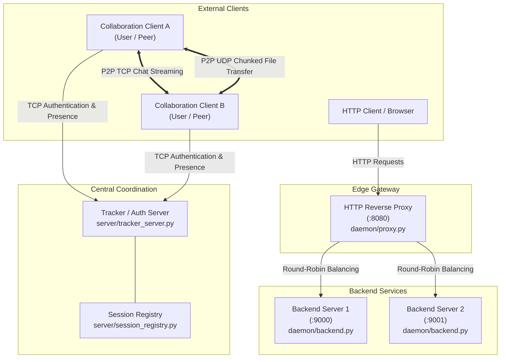

# Distributed Streaming-based Client-Server Collaboration Application

[](https://www.python.org/downloads/)
[](tests/README.md)
[](LICENSE)

> **Course:** CO3094 - Computer Networks  
> **Institution:** Ho Chi Minh City University of Technology (HCMUT - VNU-HCM)  
> **Academic Year:** 2026  
> **Repository:** [MMT (Distributed Collaboration App)](https://github.com/HuyKhanh-Kevin/MMT)

---

## 1. Project Overview

This project implements a **Distributed Streaming-based Client-Server Collaboration Application** built from the ground up using **raw TCP and UDP sockets** in Python (without relying on high-level web frameworks like Flask or Django). 

The system enables secure user authentication, online presence tracking, peer-to-peer (P2P) full-duplex text streaming, and reliable chunked file transmission with SHA-256 integrity verification, all routed through a custom **HTTP Reverse Proxy** with multi-backend **Round-Robin load balancing**.

---

## 2. System Architecture



### Architectural Layers:
1. **HTTP Reverse Proxy Layer (`daemon/proxy.py`, `start_proxy.py`, `config/proxy.conf`)**:
   - Listens on public interface (default `0.0.0.0:8080`).
   - Parses incoming HTTP/1.1 requests, extracts the `Host:` header, and resolves backend targets from virtual host configuration.
   - Dispatches traffic across multiple backend nodes using thread-safe **Round-Robin load balancing**.
   - Handles client connections concurrently using worker threads.
   - Enforces defensive HTTP error handling (`400 Bad Request` on missing headers, `404 Not Found` on unmapped virtual hosts, `502 Bad Gateway` on connection failures).

2. **Backend Application Layer (`daemon/backend.py`, `start_backend.py`, `daemon/httpadapter.py`)**:
   - Core REST application server using the teacher's `StreapRous` socket framework.
   - Dispatches HTTP requests through route hooks and custom adapters with support for raw socket packet capture and kernel RST packet dropping (macOS `pfctl` / Linux `iptables`).

3. **Central Tracker & Session Directory (`server/`)**:
   - Manages user accounts, credential verification, and active token-based session leases.
   - Maintains an in-memory directory of active online peers (IP addresses, TCP streaming ports, and UDP file ports).

4. **Client & Peer-to-Peer File Transfer (`client/`, `file_transmission/`)**:
   - Terminal-based interactive client console.
   - Direct peer-to-peer TCP streaming for real-time messaging with sequence ordering and ACK confirmation.
   - High-throughput UDP file transmission partitioning large files into 1024-byte binary chunks with 24-byte metadata framing (UUIDv4 + chunk order) and SHA-256 verification.

5. **Common Protocol Framing & Codecs (`common/`)**:
   - Custom 24-byte binary packet header (`!BBHIIIII`: Version, MessageType, Flags, StreamID, SequenceNumber, SenderID, ReceiverID, PayloadLength).
   - Wire serialization via `PacketCodec` and type-safe JSON DTO codec via `JsonPayloadCodec`.

---

## 3. Getting Started

### Prerequisites
- **Python 3.10+** (Python 3.12 recommended).
- Operating System: **Windows, Linux, or macOS**.
- **No external pip packages required**; the application uses Python's standard library (`socket`, `threading`, `struct`, `hashlib`, `uuid`, `argparse`, `unittest`).

### Repository Setup
Clone the repository and navigate into the project root:
```bash
git clone https://github.com/HuyKhanh-Kevin/MMT.git
cd MMT
```

---

## 4. Running the System

### 1. Start the Backend Server
Run one or more backend instances listening on designated ports:
```bash
# Terminal 1 (Backend on port 9000)
python start_backend.py --server-ip 127.0.0.1 --server-port 9000

# Terminal 2 (Optional: Second Backend on port 9001 for load balancing)
python start_backend.py --server-ip 127.0.0.1 --server-port 9001
```

### 2. Configure and Start the HTTP Reverse Proxy
Inspect or modify the routing table in `config/proxy.conf`:
```nginx
host "app1.local" {
    proxy_pass http://127.0.0.1:9001;
}

host "app2.local" {
    proxy_set_header Host $host;
    proxy_pass http://127.0.0.1:9000;
    proxy_pass http://127.0.0.1:9001;
    dist_policy round-robin
}
```

Launch the proxy server:
```bash
# Terminal 3 (Reverse Proxy on port 8080)
python start_proxy.py --server-ip 0.0.0.0 --server-port 8080
```

Test proxy load balancing with `curl`:
```bash
# Request routed to app2.local (balances across backends 9000 and 9001)
curl -H "Host: app2.local" http://127.0.0.1:8080/
```

### 3. Start Tracker and Clients
```bash
# Terminal 4: Start central tracker server
python -m server.tracker_server

# Terminal 5: Start Client A
python -m client.client_console

# Terminal 6: Start Client B
python -m client.client_console
```

---

## 5. Verification & Testing

The project includes an automated integration test suite containing **72 test cases** across 6 testing modules.

### Running All Integration Tests:
```bash
# Windows (PowerShell)
$env:PYTHONPATH = "."
python -m unittest discover -s tests -v

# Linux / macOS
PYTHONPATH=. python3 -m unittest discover -s tests -v
```

### Test Suite Summary:
| Test Module | Component Verified | Test Cases | Status |
|---|---|:---:|:---:|
| `tests/test_packet_codec.py` | Wire serialization, 24-byte header framing, MTU size caps, bounds | 15 | **PASSED** |
| `tests/test_tcp_connection.py` | Raw TCP handshake, echo duplex, graceful FIN disconnect, EOF | 8 | **PASSED** |
| `tests/test_http.py` | Virtual host parser, Round-Robin load balancing, 400/404 handling | 10 | **PASSED** |
| `tests/test_auth.py` | Login, Signup, Logout payloads, MessageType enums, size guards | 16 | **PASSED** |
| `tests/test_p2p.py` | PeerEndpoint model, direct duplex chat & ACK exchange, sequence order | 11 | **PASSED** |
| `tests/test_file_transfer.py` | Chunk codec, out-of-order reordering, SHA-256 integrity check | 12 | **PASSED** |
| **Total** | **End-to-End System Integration** | **72** | **100% OK** |

> For complete test case specifications and requirements mapping, see the [Integration Test Suite Documentation (tests/README.md)](tests/README.md).

---

## 6. Work Allocation

In accordance with the project requirements, work is allocated among team members as follows:

| Member | Student ID | Primary Responsibilities & Assigned Modules |
|---|---|---|
| **Phạm Tuấn** (`tuanphusimon`) | *Lead QA & Proxy* | **HTTP Reverse Proxy** (`daemon/proxy.py`, `start_proxy.py`, `config/proxy.conf`), **Integration Testing Suite** (`tests/` — 72 automated testcases), **System Documentation** (`README.md`, `tests/README.md`) |
| **Trương Huy Khánh** (`HuyKhanh-Kevin`) | *Team Lead* | **StreapRous Architecture**, Java-to-Python Migration, **Common Codecs & Protocol Framing** (`common/PacketCodec.py`, `PacketHeader.py`, `JsonPayloadCodec.py`) |
| **Nguyễn Phương Đông** (`phuongdong`) | *Core Dev* | **Tracker Server & Session Management** (`server/tracker_server.py`, `session_registry.py`, `account_store.py`), REST Route Controllers (`apps/routes/`) |
| **Lê Duy Ca** (`duyca`) | *Core Dev* | **Client Implementation & File Transmission** (`client/`, `file_transmission/file_transfer.py`, `file_connection.py`, UDP Chunked Streaming) |
| **Trần Anh Khôi** (`anhkhoi`) | *Core Dev* | **StreapRous Daemon Adapter** (`daemon/httpadapter.py`, `daemon/request.py`, `daemon/response.py`, Hook pipeline) |
| **Nguyễn Anh Tuấn** (`tuan`) | *Core Dev* | **Backend Server Process** (`daemon/backend.py`, `start_backend.py`, Raw Socket Interfacing, Kernel RST packet blocking) |

---

## 7. License

This project is developed for educational purposes under the CO3094 Computer Networks course at HCMUT and is released under the [MIT License](LICENSE).
