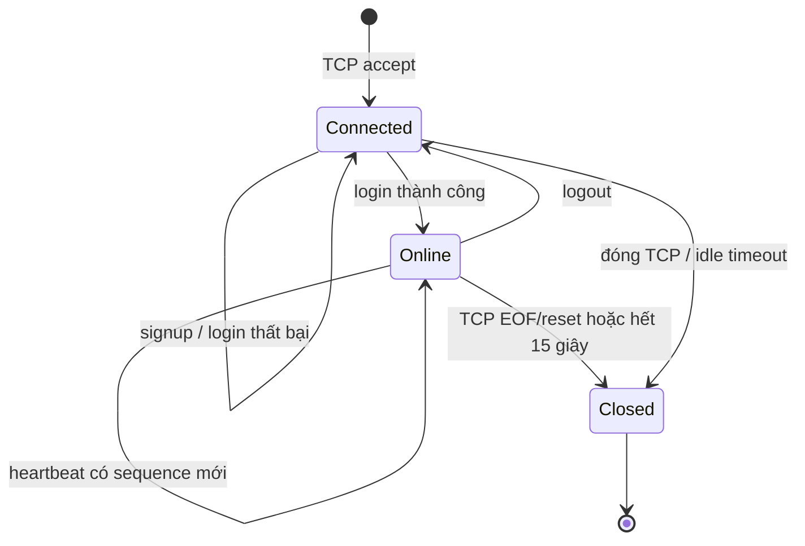

# Account, Session & Presence - giao thức Python

Đặc tả triển khai cho phần việc của Đồng trong bảng phân công. Đây là giao thức
ứng dụng chạy trên `socket.SOCK_STREAM` và `socket.SOCK_DGRAM`, không dùng Flask,
Django hoặc WebSocket. Cấu trúc header và mã message lấy từ `common` hiện tại;
các slide chỉ cung cấp nguyên lý, không quy định những mã số này.

## Phạm vi và cơ sở lý thuyết

| Tài liệu trong `docs/slide` (trang PDF) | Áp dụng |
| --- | --- |
| Đề Assignment, trang 1-4 | Authentication/discovery, socket trực tiếp, tách mạng/nghiệp vụ/UI, 10-20 client, xử lý ngắt kết nối |
| Chương 1, trang 14-15, 51, 59, 73-75, 84 | Định nghĩa message và trạng thái; phân lớp; mất gói; session do ứng dụng quản lý |
| Chương 2, trang 7-17, 103-112 | Tracker/client, endpoint IP + port; TCP cho account, UDP cho heartbeat/discovery |
| Chương 3, phần multiplexing, reliable transfer, TCP | Một kết nối điều khiển cho mỗi client; đọc đủ frame TCP; số thứ tự và retry UDP có giới hạn |
| Chương 4, phần IP, NAT, fragmentation | Lấy IP từ socket; tách cổng peer và cổng nguồn; giới hạn packet 1.200 byte |
| Chương 5, phần control plane | Discovery là thông tin điều khiển ở tầng ứng dụng, không tự thay thế routing IP |
| Chương 6, phần LAN/broadcast | Presence phát tới các endpoint đã đăng ký bằng UDP unicast fan-out |
| Chương 7, trang 13-15, 53-55, 72 | Mất gói Wi-Fi và đổi endpoint: timeout có dung sai, reconnect/login lại |
| Chương 8, trang 4, 30-40, 44, 58-64, 76 | Phân biệt xác thực, hash lưu trữ, mã hóa; token ngẫu nhiên; replay không gia hạn phiên |

PBKDF2-HMAC-SHA256 với salt 16 byte, 210.000 vòng, hash 32 byte là lựa chọn
triển khai kế thừa module Java. Chu kỳ heartbeat 5 giây, timeout 15 giây,
snapshot 30 giây và retry 3 lần là tham số của project, không phải con số từ slide.
Pre-login idle timeout là 120 giây (CLI --login-timeout), độc lập với heartbeat.

## Wire contract

Header version 2, 24 byte, big-endian:
`version:u8 | type:u8 | flags:u16 | stream:u32 | sequence:u32 | sender:u32 | receiver:u32 | payload_length:u32`.
Account dùng flags=0, stream=0, sequence khác 0; request lên tracker receiver=0.
Signup/login có sender=0; request đã xác thực có sender=user_id. Reply có sender=0,
sequence bằng request. Payload là JSON UTF-8 object tối đa 1.100 byte.

| Hoạt động | Mã | Transport | JSON |
| --- | --- | --- | --- |
| Signup / response | 12 / 13 | TCP | `username,password` / `status,reason` |
| Login / response | 1 / 2 | TCP | `username,password,tcp_port,file_udp_port` / `status,session_id,user_id,reason` |
| Logout / response | 19 / 20 | TCP | `session_id` / `status` |
| Heartbeat | 5 | UDP | `session_id,heartbeat_seq` |
| User list / response | 6 / 7 | UDP | `session_id,cursor` / `users,next_cursor` |
| Presence | 18 | UDP | `username,status` |
| Error | 10 | Cùng transport | `error_code,error_message,related_stream_id,related_sequence_number` |

`status` của signup/login là `success` hoặc `failed`; các key điều kiện được giữ
với giá trị null để phù hợp codec và test Python sẵn có. `cursor` và `next_cursor`
cũng hiện diện khi null. User online gồm `username,status,user_id,ip,tcp_port,file_udp_port`.
Presence chỉ có `online` hoặc `offline`, không mang token.

## Trạng thái và vòng đời

Mỗi tài khoản chỉ có một session. Token mới mỗi lần login, gắn với user và kết nối
TCP do server cấp ID. Heartbeat đầu tiên chốt endpoint UDP; các gói sau phải khớp
token/user/IP/cổng. Sequence cũ/trùng không gia hạn; discovery không gia hạn.
Đồng hồ monotonic đo timeout; thời gian UTC chỉ phục vụ quan sát.

Danh sách được chia trang theo số byte JSON, dùng snapshot bất biến thuộc session.
Cursor hết hạn sau 30 giây; mỗi session tối đa 4 snapshot. Retry cùng request UDP
nhận lại cùng trang, kể cả trang đầu. Client thử tối đa 3 lần, mỗi lần đợi 1 giây.
Presence là thông báo best effort; gọi lại danh sách để đồng bộ khi mất thông báo.
AccountClient.on_users tự đồng bộ khi có thông báo và mỗi 5 giây. Nếu cursor
hết hạn, online_users bắt đầu lại toàn bộ snapshot tối đa một lần.

## Ranh giới tích hợp

`apps/routes/auth_routes.py` và `tracker_routes.py` định tuyến message ứng dụng
đến nghiệp vụ account/discovery, không phải HTTP endpoints. UI native gọi
AccountClient hoặc Client (cùng implementation/session). Cầu nối HTTP account
được cung cấp tại apps/account_http.py và apps/routes/account_http_routes.py.
HTTP dùng JSON và Bearer access_token riêng; không thay đổi wire contract TCP/UDP
hoặc cung cấp giao thức Java song song. Xem hướng dẫn tích hợp để biết endpoint.

Token/IP/cổng không thay thế xác thực mật mã. Module này hash mật khẩu trên đĩa;
wire TCP/UDP hiện chưa mã hóa, cần ghép module Security trước khi dùng trên mạng
không tin cậy. NAT traversal, chat routing, reliable file transfer, BBR/CUBIC và
giao diện HTTP thuộc các phần việc khác. Module account cung cấp endpoint và API
xác thực để các phần đó tích hợp.
