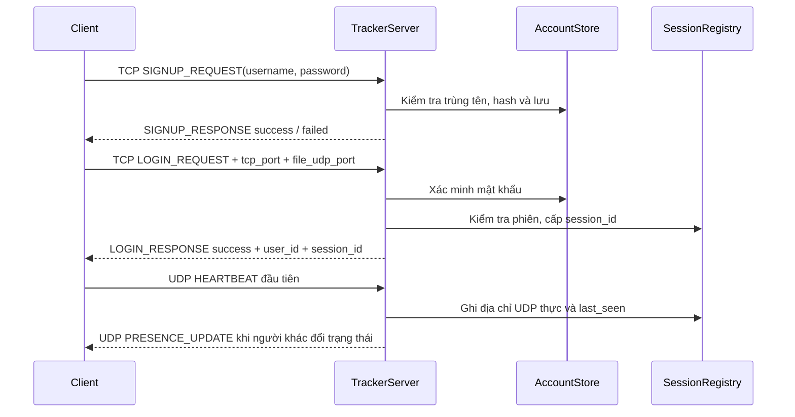

# Giải thích phần Account Session và Presence của Đồng

Phần này xác định người dùng là ai, người đó đang online ở đâu và khi nào cần loại khỏi danh sách. Nó cung cấp endpoint cho các phần chat và truyền file của nhóm.

## Các file cần nắm

| File | Trách nhiệm |
| --- | --- |
| `server/AccountStore.java` | Kiểm tra username/password, tạo tài khoản, lưu salt/hash và kiểm tra mật khẩu |
| `server/SessionRegistry.java` | Cấp token, chống đăng nhập đồng thời, quản lý endpoint, heartbeat và trạng thái online |
| `server/OnlineDirectory.java` | Chia danh sách online thành các trang JSON tối đa 1.100 byte |
| `server/TrackerServer.java` | Nhận TCP/UDP, gọi các xử lý trên, trả phản hồi và phát presence |
| `server/AccountRequestHandler.java` | Đầu vào xử lý các request account/discovery để ghép với server |
| `client/PeerEndpoint.java` | Endpoint TCP và UDP truyền file lấy từ danh sách online |
| `client/AccountClient.java` | API mẫu cho client chính: signup, login, logout, onlineUsers, onPresence |
| `client/AccountDemo.java` | Giao diện dòng lệnh để demo phần việc này |
| `common/payload/` | Dữ liệu JSON cho từng loại gói tin |
| `src/test/java/server/` | Kiểm thử nghiệp vụ và chạy nhiều client bằng socket thật |

Đường dẫn các file Java trong bảng tính từ `src/main/java/`, trừ dòng kiểm thử.

## Ba khái niệm dễ nhầm

**Account** là tài khoản lâu dài. Nó gồm username, `user_id`, salt, hash mật khẩu và số vòng hash. Tài khoản vẫn tồn tại khi người dùng offline hoặc server khởi động lại.

**Session** là một lần đăng nhập. Server sinh `session_id` ngẫu nhiên 32 byte, mã hóa Base64 URL thành chuỗi 43 ký tự. Mỗi lần login có token mới; token hết hiệu lực sau logout, timeout hoặc đứt kết nối TCP. `user_id` vẫn giữ nguyên.

**Presence** là trạng thái online/offline suy ra từ session. Một tài khoản chỉ có tối đa một session đang hoạt động. Các thao tác trên các bảng phiên được khóa cùng nhau để hai luồng không cùng login thành công cho một tài khoản.

Ví dụ: Alice có `user_id=1`. Lần login đầu nhận token A; logout rồi login lại nhận token B. Gửi heartbeat bằng A sẽ bị từ chối dù `user_id` vẫn là 1.

## Luồng đăng ký và đăng nhập



Đăng ký không tự đăng nhập. Khi signup, server kiểm tra username theo `[A-Za-z0-9_]{1,32}`, password gồm 8–128 ký tự ASCII in được. Tên có phân biệt hoa thường: `Alice` và `alice` là hai tài khoản khác nhau.

Password được hash bằng `PBKDF2WithHmacSHA256`, salt ngẫu nhiên 16 byte, 210.000 vòng, kết quả 32 byte. File tài khoản không lưu password gốc. Khi login, server lấy salt đã lưu, hash password vừa nhận rồi so sánh bằng `MessageDigest.isEqual`.

Ghi tài khoản dùng file tạm cùng thư mục rồi thay thế file chính, ưu tiên atomic move. Chỉ thêm vào RAM sau khi ghi thành công. Nếu hai client đồng thời signup một tên, server kiểm tra trùng lần nữa sau khi hash; chỉ một client tạo được tài khoản. Không chạy nhiều tiến trình server cùng ghi một file tài khoản.

Khi login thành công, server lưu:

| Dữ liệu | Nguồn và ý nghĩa |
| --- | --- |
| `user_id`, username | Tài khoản đã xác thực |
| `session_id` | Token ngẫu nhiên của lần login |
| IP | Lấy từ kết nối TCP đang nhận, không nhận IP do client tự khai |
| `tcp_port` | Cổng client lắng nghe kết nối peer, trong khoảng 1–65535 |
| `file_udp_port` | Cổng module file nhận UDP, trong khoảng 1–65535 |
| Kết nối TCP điều khiển | Gắn với phiên để client khác không thể logout hộ |
| `last_seen` | Thời điểm heartbeat hợp lệ gần nhất, khởi tạo tại login |
| Endpoint UDP presence | IP/cổng nguồn của heartbeat đầu tiên |

`tcp_port` là cổng peer đang lắng nghe, khác cổng nguồn tạm của kết nối client → server. `file_udp_port` là cổng truyền file, khác socket UDP dùng heartbeat/discovery. Nếu cần đổi cổng đã đăng ký, logout và login lại.

Login sai tài khoản/mật khẩu trả `failed / INVALID_CREDENTIALS`; tài khoản đang online trả `failed / ALREADY_ONLINE`; cổng ngoài miền hợp lệ trả `failed / INVALID_PORT`. JSON thiếu trường, sai kiểu hoặc header sai trả gói `ERROR`.

## Heartbeat và phát hiện offline

Client gửi UDP heartbeat ngay sau login, rồi mỗi 5 giây:

```json
{"session_id":"token_cua_phien","heartbeat_seq":1}
```

Server kiểm tra đồng thời token còn hạn, `sender_id` đúng tài khoản, IP nguồn trùng IP khi login và cổng UDP nguồn khớp cổng đã được ghi nhận. Heartbeat đầu tiên chốt endpoint UDP; những heartbeat sau không được tự đổi cổng.

`heartbeat_seq` tăng từ 1, tối đa 4.294.967.295. Gói trùng hoặc đến muộn không được cập nhật thời gian sống. Chỉ heartbeat hợp lệ và có sequence mới làm mới deadline; yêu cầu danh sách online không kéo dài phiên.

Đồng hồ đo hạn dùng `System.nanoTime`, tránh thay đổi giờ hệ thống làm sai timeout. Trường `last_seen` dùng `Instant` để quan sát. Nếu đủ 15 giây kể từ heartbeat cuối, server loại session, đóng TCP điều khiển và gửi presence offline cho các client khác. Vòng quét chạy mỗi 100 ms; xác thực cũng từ chối token đã hết hạn ngay cả trước lượt quét.

Khi TCP đóng/reset, server dọn phiên ngay khi đọc được EOF/lỗi. Nếu đường truyền hỏng im lặng và TCP chưa báo lỗi, heartbeat timeout vẫn dọn được. Các thao tác dọn là idempotent: timeout và TCP đóng cùng lúc không tạo hai sự kiện offline.

Khi `heartbeat_seq` hết miền số, cần tạo phiên mới; token đã hết hạn không được khôi phục bằng heartbeat đến muộn.

## Danh sách online và presence

Client gửi `USER_LIST_REQUEST` bằng UDP, từ cùng socket gửi heartbeat:

```json
{"session_id":"token_cua_phien","cursor":null}
```

Phản hồi có endpoint để module chat/file dùng:

```json
{"users":[{"username":"alice","status":"online","user_id":1,"ip":"127.0.0.1","tcp_port":5001,"file_udp_port":6001}],"next_cursor":null}
```

Nếu danh sách dài, `next_cursor` chứa mã trang tiếp theo. Client gửi lại `session_id` và cursor này cho tới khi nhận `next_cursor=null`. Không cắt bớt người dùng để ép gói vừa kích thước.

Mỗi chuỗi trang dùng một snapshot tạm, nên người dùng online/offline giữa chừng không làm mất hoặc lặp mục do dịch chuyển vị trí. Gửi lại cùng cursor hợp lệ nhận cùng trang. Cursor thuộc một session, hết hạn sau 30 giây; mỗi session giữ tối đa 4 snapshot gần nhất. Cursor lỗi, hết hạn hoặc thuộc session khác nhận `ERROR 1003 / INVALID_CURSOR`. Client có thể bắt đầu lại bằng `cursor=null`. Để tương thích constructor cũ, server cũng hiểu yêu cầu không có `cursor` là trang đầu.

Client mẫu đợi mỗi phản hồi UDP tối đa 1 giây, thử tối đa 3 lần với cùng số tham chiếu gói. `onlineUsers()` tự lấy đủ các trang. Vì UDP có thể mất gói, presence đóng vai trò thông báo thay đổi; danh sách lấy lại bằng `users` là cách đồng bộ trạng thái hiện tại.

Khi login/logout/timeout/đứt TCP, server gửi một bản `PRESENCE_UPDATE` tới từng endpoint đã đăng ký của các client còn online:

```json
{"username":"bob","status":"offline"}
```

Đây là fan-out UDP unicast tới các peer đã biết, không dùng địa chỉ broadcast toàn LAN. Nó giữ đúng nội dung presence và tránh gửi sang các máy ngoài danh sách. Bản tin chỉ có username và status; client cần endpoint/user_id mới thì gọi lại `onlineUsers()`.

## Logout và ràng buộc phiên

Client gửi TCP `LOGOUT_REQUEST` chứa `session_id`; header chứa `sender_id=user_id`. Server yêu cầu token, user và chính kết nối TCP đã login phải khớp. Sau khi hủy phiên, server trả `{"status":"success"}` và phát offline.

Client khác biết `user_id` vẫn không có quyền logout hộ. Cả trường hợp biết token nhưng gửi qua kết nối TCP khác cũng bị từ chối. Token cũ không dùng được sau logout. TCP còn mở sau logout có thể login lại; sau timeout server đã đóng TCP nên cần tạo `AccountClient` mới.

## Giao thức và những điểm đã thống nhất trong mã

Giữ header version 2, 24 byte, big-endian và các mã trong `common.MessageType`. Account/presence dùng `stream_id=0`, `receiver_id=0` khi gửi lên server, flags bằng 0 và `sequence_number` khác 0. Phản hồi dùng cùng sequence của yêu cầu để client ghép đúng phản hồi. Presence có sequence riêng từ server.

| Hoạt động | Mã yêu cầu / phản hồi | Giao thức |
| --- | --- | --- |
| Signup | `0x0C` / `0x0D` | TCP |
| Login | `0x01` / `0x02` | TCP |
| Logout | `0x14` / `0x15` | TCP |
| Heartbeat | `0x05` | UDP |
| Online list | `0x12` / `0x06` | UDP |
| Presence | `0x13` | UDP từ server |
| Lỗi | `0x0A` | Cùng giao thức với yêu cầu |

Các trường JSON dùng snake_case. `LOGIN_RESPONSE.status` là chuỗi `success/failed`; `session_id` và `user_id` chỉ xuất hiện khi thành công, `reason` chỉ xuất hiện khi thất bại. Getter `isStatus()` vẫn dùng được trong Java như một giá trị boolean tiện ích.

`ErrorPayload` thêm `related_stream_id` và `related_sequence_number` để chỉ đúng gói lỗi. Giữ mã lỗi số thập phân 1001–1004 trong `common.ErrorCode`: sai thông tin đăng nhập, trùng tên, sai payload và chưa xác thực. Header/gói không thể giải mã bị loại; server không đoán số tham chiếu để phản hồi. TCP bị lỗi framing thì đóng kết nối; JSON sai trong một frame đầy đủ được báo lỗi và có thể gửi yêu cầu tiếp theo.

Các bản tài liệu đầu vào có chỗ khác nhau về transport discovery và mốc timeout. Mã này theo bảng message registry và mục Authentication: signup/login/logout qua TCP; heartbeat/discovery/presence qua UDP; heartbeat 5 giây và hết hạn 15 giây. Không thêm ngưỡng 30 giây từ phần Security vào lifecycle Authentication.

## Cách ghép với phần của thành viên khác

Không sửa mã trong `branch/`. Phần chung ở gốc có thêm các payload signup/presence, endpoint, cursor và sửa các tên trường từng không khớp tài liệu. Khi ghép nhánh, cần dùng cùng phiên bản `common` ở gốc.

Client chính có thể gọi:

```java
AccountClient account = new AccountClient(serverIp, 5000, 5000,
        peerListeningSocket.getLocalPort(), fileDatagramSocket.getLocalPort());
account.onPresence(update -> refreshOnlineUserView());
account.signup("alice", "password123");
LoginResponse result = account.login("alice", "password123");
List<UserInfo> peers = account.onlineUsers();
account.logout();
account.close();
```

Đoạn trên minh họa các điểm gọi; `refreshOnlineUserView()` là hàm của UI. Callback presence chạy trên một luồng riêng, nên có thể gọi `onlineUsers()` trong callback mà không chặn luồng nhận UDP. Khi dùng GUI, vẫn cần chuyển thao tác cập nhật thành phần giao diện về luồng UI.

Client theo dõi kết nối TCP ở nền: khi server đóng kết nối vì timeout hoặc mất kết nối, `isAuthenticated()` và `isConnected()` tự chuyển thành `false`. Logout bình thường chỉ xóa trạng thái đăng nhập và vẫn giữ kết nối để login lại. `peerEndpoint(userID)` tải lại danh sách online rồi trả endpoint TCP/UDP cho module file, hoặc báo `2001: RECIPIENT_OFFLINE` nếu không có người nhận.

Hướng dẫn tích hợp tiếp theo và cách demo các tiêu chí trong ảnh: [INTEGRATION_ACCOUNT_SESSION.md](INTEGRATION_ACCOUNT_SESSION.md).

Ở server, module routing có thể dùng `server.sessions().findOnlineUser(userID)` hoặc `onlinePeers()` để đọc endpoint. Kết quả là bản sao bất biến, không trả token. `SessionRegistry.authenticateUdp(...)` có thể dùng khi payload của module đó mang token và dùng cùng endpoint UDP điều khiển; nếu module chat dùng socket riêng, nhóm cần thống nhất cơ chế gắn socket đó với phiên.

Server nhận tối đa 64 kết nối TCP điều khiển được xử lý đồng thời, mỗi kết nối một worker. Mỗi kết nối chưa login có read timeout 15 giây để dọn client im lặng. Một vòng UDP và một bộ quét phiên hoạt động riêng, nên một client chờ TCP không chặn heartbeat của những client khác.

Hash tài khoản bảo vệ dữ liệu lưu trên đĩa. Lớp mã hóa đường truyền chưa nằm trong module này: gói account và token hiện dùng codec chung chưa mã hóa. Khi ghép module Security, cần bảo vệ TCP đăng nhập và UDP token; ràng buộc token/IP/cổng hiện tại không thay thế xác thực mật mã hoặc TLS.

## Các ca kiểm thử

| Nhóm | Kiểm chứng |
| --- | --- |
| Tài khoản | Signup thành công, trùng tên, username/password lỗi, phân biệt hoa thường |
| Lưu trữ | Không có password gốc trong file, mở lại giữ user_id, ghi lỗi không tạo account trong RAM |
| Đồng thời | Nhiều signup một tên chỉ một người thắng; hai login một tài khoản chỉ một phiên |
| Phiên | Token mới sau login lại, token cũ bị từ chối, logout phải đúng kết nối |
| Heartbeat | Gia hạn hợp lệ, không gia hạn bằng replay/list, sai user/IP/cổng bị từ chối |
| Timeout | Hết hạn đúng 15 giây bằng đồng hồ giả và qua socket thật với heartbeat 5 giây |
| Presence | Login → online; logout, timeout, TCP đóng → offline; không phát offline hai lần |
| Discovery | 20 người không bị thiếu, gói ≤1.100 byte, snapshot ổn định, cursor riêng từng phiên và có hạn |
| Gói lỗi | JSON thiếu/sai/trùng trường, UDP quá ngắn/quá dài không làm server ngừng hoạt động |
| Tải đồng thời | 20 client signup/login, mỗi client lấy đủ 20 người online, đóng xong registry trống |

Chạy `mvn test` hoặc lệnh Maven cục bộ trong README để xem kết quả thực tế. Một ca đợi hết hạn 15 giây thật nên toàn bộ bộ kiểm thử cần hơn 15 giây.
