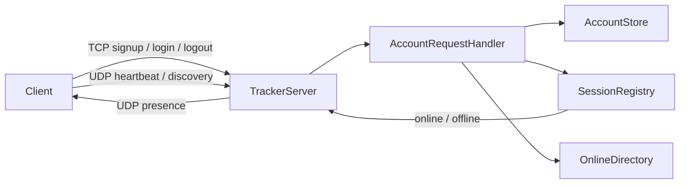

# Tích hợp account session và presence với server

Phần tích hợp dùng `TrackerServer` đang có trong thư mục gốc. Các bản trong `branch/` hiện chưa có server hoặc module truyền file hoàn chỉnh để ghép thêm. Bộ xử lý account đã được tách ra để server chung của nhóm có thể gọi trực tiếp.

## Kết quả theo phần việc trong ảnh

| Yêu cầu | Cách thực hiện | Kiểm chứng |
| --- | --- | --- |
| Tích hợp account/session/presence với server | `TrackerServer` gọi `AccountRequestHandler` cho TCP/UDP; dùng chung một `SessionRegistry` | Các ca chạy socket thật trong `TrackerServerTest` và `AccountIntegrationTest` |
| Kiểm tra session của request | Token, sender ID, hạn phiên và kết nối/địa chỉ nguồn phải khớp; mọi trang discovery đều xác thực lại | Token sai, sender sai, nguồn UDP sai, logout từ TCP khác và token cũ đều bị từ chối |
| Cập nhật IP/cổng client | Login lấy IP thật từ TCP và lưu `tcp_port`, `file_udp_port`; logout/login lại cập nhật endpoint | Kiểm tra thay IP/cổng trong registry và thay cổng qua socket thật |
| Logout và heartbeat timeout | Xóa phiên, phát offline; timeout đóng TCP và client tự xóa trạng thái login | Timeout 15 giây thật, logout và đóng TCP đột ngột |
| Danh sách online vượt payload | Snapshot chia trang theo số byte JSON; client lấy đủ các trang | 20 username dài 32 ký tự, mỗi payload ≤1.100 byte, không thiếu/trùng user |
| Client lấy endpoint để truyền file | `AccountClient.peerEndpoint(userID)` lấy danh sách mới và trả hai địa chỉ socket | Kết nối được TCP và gửi nhận một chunk 1.024 byte qua cổng UDP vừa khám phá |

`user_id` giữ nguyên qua các lần login; `session_id` được tạo mới. Thay cổng cần logout/login lại theo giao thức đã thống nhất. Server không nhận IP do client tự khai trong JSON. Cổng heartbeat/discovery được lấy từ heartbeat đầu tiên và không phải `file_udp_port`.

## Đường đi của request



`AccountRequestHandler` giải mã payload, xác thực và tạo packet trả lời. `TrackerServer` chịu trách nhiệm đọc/ghi socket, quản lý worker, quét timeout và gửi presence. Cách tách này cho phép server chung của nhóm dùng phần nghiệp vụ account mà không cần mở thêm một server account riêng.

## Ghép với server của nhóm

Tạo các đối tượng sau một lần cho toàn server, không tạo mới cho từng request:

```java
AccountStore accounts = new AccountStore(Path.of("data/accounts.json"));
SessionRegistry sessions = new SessionRegistry();
OnlineDirectory directory = new OnlineDirectory();
AccountRequestHandler handler = new AccountRequestHandler(accounts, sessions, directory);
```

Mỗi kết nối TCP được cấp một UUID riêng. UUID này và địa chỉ nguồn phải do server lấy từ socket:

```java
UUID connectionID = UUID.randomUUID(); // Một lần cho mỗi socket được accept.
Packet response = handler.handleTcp(connectionID, socket.getInetAddress(), request);
PacketIO.writePacket(socket.getOutputStream(), response);
```

Với UDP:

```java
UdpPacketIO.ReceivedPacket received = UdpPacketIO.receivePacket(udpSocket);
Packet response = handler.handleUdp(received.packet(), received.source());
if (response != null) {
    UdpPacketIO.sendPacket(udpSocket, received.source(), response);
}
```

Heartbeat hợp lệ không có phản hồi. Các yêu cầu thất bại trả `ERROR`, trừ thất bại nghiệp vụ signup/login được diễn đạt bằng `status=failed` và `reason`. Bộ xử lý chỉ nhận các message account/discovery; server chung phải định tuyến message chat/file sang handler tương ứng của chúng.

Khi thêm request được bảo vệ vào server, kiểm tra session trước khi làm việc:

```java
SessionRegistry.Peer caller = sessions.authenticateTcp(sessionID, senderID, connectionID);
// Chỉ xử lý yêu cầu sau khi hàm trên thành công.
```

Với UDP điều khiển, dùng `authenticateUdp(sessionID, senderID, source)`. Lỗi xác thực ném `AccountException` mã `1004`. `user_id` riêng lẻ không chứng minh client đã đăng nhập. Socket peer hoặc UDP chat riêng cần cơ chế xác thực của module tương ứng; không tự xem chúng như socket điều khiển đã được đăng ký.

Server tích hợp cũng cần thực hiện các bước lifecycle đang có trong `TrackerServer`:

- Khi TCP kết thúc, gọi `sessions.disconnect(connectionID)` trong `finally`.
- Quét `sessions.expire()` mỗi 100 ms; lấy `drainDisconnectedConnections()` và đóng đúng socket hết hạn.
- Lấy `drainChanges()` và gửi presence tới endpoint đã đăng ký của các peer còn online; chỉ một bộ phát lấy các sự kiện này.
- Gọi `directory.cleanup()` để bỏ snapshot quá 30 giây.
- Không tái sử dụng UUID của TCP cũ cho kết nối mới. Kết nối đang chờ đóng vì timeout bị cấm login lại.

## Dùng endpoint ở client

```java
PeerEndpoint target = accountClient.peerEndpoint(recipientUserID);
Socket peerControl = new Socket();
peerControl.connect(target.tcp(), 3000);
UdpPacketIO.sendPacket(fileSocket, target.fileUDP(), fileChunkPacket);
```

`fileSocket` và `fileChunkPacket` thuộc module truyền file. Module gọi chịu trách nhiệm đóng socket và thực hiện giao thức chấp nhận file, ACK, gửi lại, ghép file và kiểm tra hash. Ca tích hợp ở đây kiểm chứng địa chỉ được lấy đúng và một chunk đến đúng cổng; chưa thay thế kiểm thử truyền file đầy đủ.

`peerEndpoint()` làm mới danh sách trước khi chọn người nhận, tránh dùng cổng cũ từ một lần login trước. Peer vẫn có thể offline ngay sau phản hồi; module file cần xử lý lỗi kết nối/timeout và làm mới discovery nếu muốn thử lại.

## Demo bằng terminal

Biên dịch và chạy kiểm thử từ thư mục dự án:

```powershell
cd D:\BKU\Project\MMT
.\.tools\apache-maven-3.9.9\bin\mvn.cmd "-Dmaven.repo.local=.tools/m2" package
```

Chạy server và hai client bằng ba terminal:

```powershell
# Terminal 1
java -jar D:\BKU\Project\MMT\target\collaboration-app-1.0-SNAPSHOT.jar

# Terminal 2 và 3, mỗi terminal chạy một client
java -cp D:\BKU\Project\MMT\target\collaboration-app-1.0-SNAPSHOT.jar client.AccountDemo
```

1. A signup/login `alice`, B signup/login `bob`; nhập `users` để lấy user ID.
2. A nhập `endpoint`, rồi nhập ID của Bob. Chương trình in endpoint TCP và UDP truyền file.
3. B nhập `logout`, rồi `status`: kết nối còn mở nhưng đã đăng xuất. A gọi `endpoint` cho Bob sẽ nhận `RECIPIENT_OFFLINE`.
4. B login lại, nhập `pause`, chờ trên 15 giây rồi nhập `status`: kết nối đã đóng và trạng thái login đã bị xóa. A nhận presence offline.
5. Chạy lại client B, login Bob, rồi A gọi `endpoint` lần nữa. Các cổng mới lấy từ socket mới được cập nhật đúng.

Client demo chỉ giữ các cổng peer để đăng ký endpoint; kiểm chứng gửi nhận chunk thực hiện trong `AccountIntegrationTest`. Callback `onPresence` chạy ở luồng riêng nên có thể gọi `onlineUsers()` để làm mới danh sách. GUI vẫn cần đưa thao tác vẽ về luồng UI.

Bộ kiểm thử sau tích hợp gồm 27 ca. Kết quả chi tiết được Maven ghi vào `target/surefire-reports/`. Lớp mã hóa đường truyền vẫn cần ghép với module Security của nhóm.
